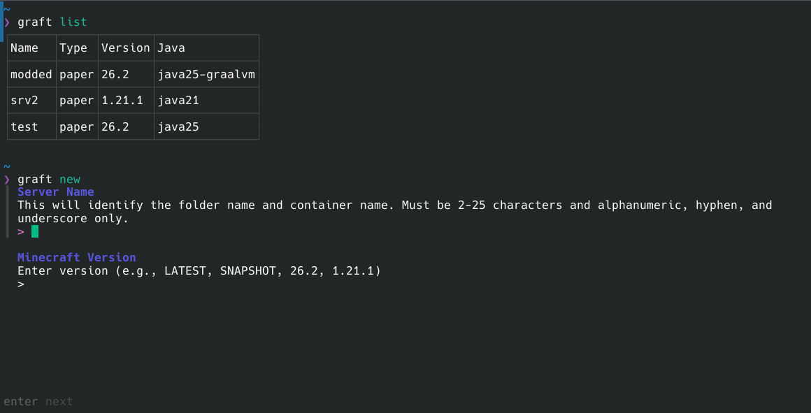

# Graft

A lightweight Linux CLI/TUI tool for setting up and managing servers in Docker Compose. 

## Why Graft?

- Lightweight: Single Go binary with Docker Compose being the only dependency. Just install and use.

- Stateless: Graft works directly with Compose configurations. You can add existing servers or manually edit configuration without issue.

- Secure: No admin web interface/API by default, simply use SSH to prevent unnecessary exposure.

## Install From Source

1. Install go, docker, and docker compose. Add user to docker group.

2. Run `go install github.com/andrewskio/graft@latest`. Make sure the Go bin directory is added to path.

3. Optionally, copy existing Compose Minecraft servers to Graft directory. 

    - Server data is stored in `~/.local/share/graft/servers`. To add an existing Compose server, simply move it into a subdirectory here (e.g., `~/.local/share/graft/servers/mysrv/compose.yml`). 
    - Ensure the Minecraft server is the only service defined in the Compose file, and the Compose file starts with `name: [server_name]`

4. Run `graft help` to get started. Optionally, run `graft ac` and restart your terminal to add completions.

